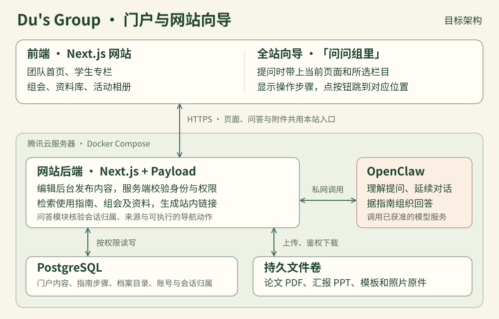
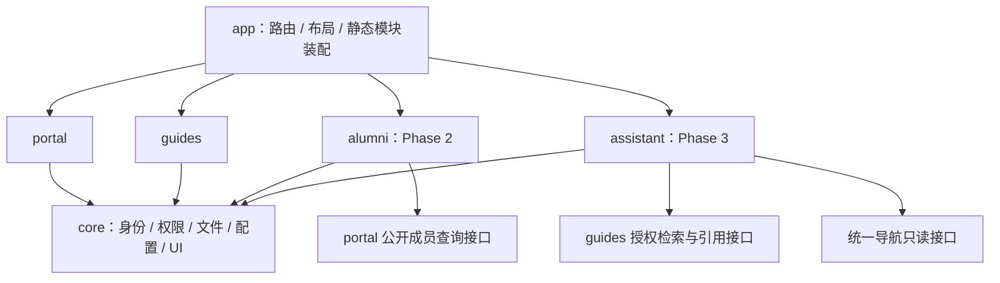

# 总体架构：以培养指南为核心的科研团队门户

目标架构待评审，2026-11-26 更新。当前可运行的是 `work/du-group-studio` 中的首页、档案和本机组会查询。下图描述拟部署的正式网站。

## 1. 现状、目标与决策

已有原型用 HTML、浏览器 JavaScript 和一个 Node.js 服务展示本机目录。首页可以按汇报人找到 PDF。正式版可以复用这套目录解析、档案分类和文件定位规则。以下规模、资源和验收阈值为设计建议。

推荐 **TypeScript + Next.js App Router + Payload CMS + PostgreSQL 的模块化单体**。同一仓库、同一 Node.js 应用部署门户、指南与后台；使用 Payload 已有身份认证、Collection、访问控制、上传及版本能力。指南优先上线，地图和 AI 按阶段启用。其他可落地总体方案及许可证依据见 [技术选型](tech-selection.md)。

评审可沿两条线阅读。先用[模块设计](module-design.md)与[数据模型](data-model.md)追踪一篇内部指南从草稿、发布到撤回的完整路径，再按[开发路线图](roadmap.md)核对每期向读者和编辑人员交付的能力。

Payload 能直接安装在 Next.js 应用中，服务端可以通过 Local API 读取内容，无需为每个页面额外部署后端。这契合本项目的动态权限和非技术成员维护要求。[安装说明](https://payloadcms.com/docs/getting-started/installation)、[Local API](https://payloadcms.com/docs/local-api/overview)

首期不建立微服务、微前端、消息总线、运行时插件市场或第二套身份体系。模块边界依靠静态导入、公开接口及测试维持。只有出现独立团队、独立扩缩容或不可信第三方代码执行需求，才重新评估拆分。

## 2. 全站架构与使用向导



**正常浏览。** 学生从首页了解团队与方向，进入学生专栏读新生指南、科研经验等内容，在组内档案查组会、资料或相册。页面和内容后台共用 Next.js + Payload 应用。PostgreSQL 存指南、目录、账号与可见范围，持久文件卷存原件。读者可以随时直接浏览，模型故障时仍能按目录找材料。

**向导回答什么。** 问“第一次来，这个网站怎么用”，向导依据已发布的网站使用指南简述上述入口。问“怎么找上周的汇报”，它给出“进入组会 → 按日期筛选 → 打开汇报附件”的步骤，附「进入组会」。已知姓名、想直接取文件时，才查询实际档案并返回可打开的附件。首页、专栏、档案页使用同一向导组件，各页提供当前栏目和选中记录的标识。

**答案怎样跟页面一致。** 负责人在现有指南栏目中维护“网站使用”主题，每项写适用页面、操作步骤和要打开的功能。指南页与助手使用同一发布版本。前端代码维护功能标识对应的真实路由、页签或控件。后端只返回已启用、当前读者可访问的导航目标，用户点击后前端执行跳转或高亮。按钮换位置只需更新页面绑定。需要屏幕内分步演示时，可直接使用 [Driver.js](https://driverjs.com/docs/configuration)。

**连续对话如何复用。** 浏览器向本站问答接口发送问题、当前页面和本站会话标识。服务端核实会话归属与资料权限，并用每段会话独立的标识调用私网 OpenClaw。同一段对话复用同一标识。公开站点说明可参与续聊，组内引用和下载每轮按当前权限回查。含已撤回资料或权限已变化的旧模型上下文须失效，再用仍可读取的来源继续。本地原型只做单轮目录查询，Gateway 和正式身份系统属于后续接入。[OpenClaw 官方会话说明](https://docs.openclaw.ai/gateway/openai-http-api#session-behavior)

公开内容可以缓存；组内内容、预览、后台和用户相关响应不进入共享缓存。身份检查发生在服务端读取与下载边界，不只发生在导航或页面组件。站点地图、SEO 元数据、搜索摘要、关联推荐、地图聚合和 AI 引用都必须复用相同的可见性规则。

Payload Local API 默认可绕过访问控制；面向用户的读取必须明确传入用户上下文并设置 `overrideAccess: false`。仅可信迁移或种子脚本允许显式管理权限；不能把该默认值带入公共页面。[Local API 访问选项](https://payloadcms.com/docs/local-api/overview)

## 3. 模块依赖与边界



箭头表示调用或依赖，不表示数据归属。`core` 不依赖业务模块；门户不能反向调用 AI。`portal` 持有成员及成果，`guides` 持有文档树与正文，`alumni` 持有去向及公开授权，`assistant` 持有检索编排与提供商适配。共享数据库不意味着模块可以任意查询他人的内部表。

路由仍是 Next.js 文件路由。静态模块清单统一装配导航、Collection、后台分组和功能开关，不动态生成任意文件路由。启用校验检查依赖，停用同时关闭入口、服务端路由及任务；停用不删除历史数据。未来第三方扩展须代码审查、版本锁定、许可证检查、迁移测试后随应用发布；同进程模块不是安全沙箱。具体合同见 [模块设计](module-design.md)。

建议的代码归属如下。Phase 1 仅创建实际使用的目录；后续模块在对应阶段加入。

```text
src/
  app/(site)/             门户和指南的文件路由，调用所属模块的查询
  app/(payload)/          官方后台及 API 路由
  modules/portal/         成员、方向、成果、新闻的 schema 和查询
  modules/guides/         培养阶段、指南、搜索及文档阅读组件
  modules/alumni/         去向、同意记录和地图查询（Phase 2）
  modules/assistant/      引用、检索编排与模型适配（Phase 3）
  modules/registry.ts     汇集受信任的静态模块声明
  core/                   会话身份、权限公共规则、环境配置与附件访问
  components/ui/          跨模块使用的导航、表单、排版与状态组件
  migrations/             统一按发布顺序执行的数据库变更
  payload.config.ts       组合所有已安装的 Collection、Global 与适配器
```

## 4. 内容、权限和可维护性

指南正文以数据库中的 **Markdown 文本为唯一来源**；后台提供编辑与预览，渲染结果与搜索文本均可重建。首期不执行 MDX/JSX，也不在 Git 和数据库中维护两份可编辑正文。图片及附件通过资源 ID 关联，导出时带上 Markdown、元数据和资源清单。代码片段、表格、标题锚点与站内链接属于必要阅读能力；任意 HTML 和脚本不开放。

以培养阶段和层级导航组织研一、研二、研三内容，分类、标签、关联指南作为独立元数据。首期先完成基本字段和浏览；多维筛选、标签治理和推荐排序放到 Phase 2。正文版本和发布版本分离，修改已发布内容不会自动将草稿公开。

访问状态分成两条轴：`draft/published` 决定是否已发布；`public/internal` 决定受众。角色为 member/editor/admin，访客匿名；编辑者可写草稿，管理员审核发布并管理账号与权限；具体角色组合和实体关系以 [数据模型](data-model.md) 为准。成员不能自行提升角色，编辑者不能用普通字段更新绕过发布权限。

附件自身有权限，不能仅依赖父文档隐藏。内部文件不放在 Next.js `public/` 或可被代理直接读取的目录；下载由认证接口鉴权。公开转内部、撤回发布或校友撤销授权时，同时失效页面、摘要、附件访问与派生索引。公开文件一旦被下载，系统无法保证追回已有副本。

## 5. 中文全文检索的渐进方案

Phase 1 提供覆盖标题与完整正文的数据库子串搜索，标题命中优先，结果分页，先过滤权限再计算摘要和结果数。查询使用参数绑定，并将 `%`、`_` 作为用户文字处理；限制长度与返回量。该方案能找字面内容，但不承诺中文分词、同义词、拼音或语义召回。

PostgreSQL 内置文本解析器不能直接被视为适合本项目的中文分词方案。`pg_trgm` 可以支持部分 `LIKE/ILIKE` 索引查询，但短关键词及缺少可提取三元组时仍可能扫描，必须在实际中文数据与数据库 locale 下验证；它也不是中文语义搜索。[解析器文档](https://www.postgresql.org/docs/current/textsearch-parsers.html)、[pg_trgm](https://www.postgresql.org/docs/current/pgtrgm.html)

建议用至少 30 条真实中文问题形成固定评测集，覆盖双字词、英文缩写、标题、正文、标签、无结果与私有内容。以下任一情况触发升级评估，而非直接自动切换：

- 优化查询后，代表性数据量和并发下搜索 p95 仍高于 500ms；先记录服务器配置、数据量、并发和查询分布。
- 预期可命中的评测题 Top-5 命中率低于 90%，主要失败确为分词、同义词或排序能力。
- 用户明确需要拼写容错、复杂筛选或跨模块统一检索，而简单查询成本已明显上升。

Phase 2 优先评估 Meilisearch：其官方文档列出基于 jieba 的中文分词。只有同一评测集证明收益、且团队接受新增服务备份与运维，才采用。[语言支持](https://www.meilisearch.com/docs/resources/help/language)

外部索引是可重建副本，数据库是事实来源。查询服务先限定权限范围，返回前再次核对数据库权限与发布版本；过滤、分页、摘要和总数均不能泄露隐藏文档。撤回立即由数据库阻断访问，索引随后重建或删除；不能把“等待索引同步”当成撤权窗口。Phase 3 是否需要向量检索由问答质量评估决定，不以引入 RAG 为理由强制更换普通搜索。

## 6. 地图与 AI 的集成位置

地图推荐 MapLibre GL JS，利用 GeoJSON 聚合和浏览器渲染支持世界、中国视图以及缩放交互；ECharts 更适合统计概览，具体取舍见技术选型。底图、边界、字体、瓦片及使用许可单独核验，MapLibre 的开源许可不授予这些数据的使用权；演示瓦片不能作为生产承诺。[MapLibre 文档](https://maplibre.org/maplibre-gl-js/docs/)、[聚合示例](https://maplibre.org/maplibre-gl-js/docs/examples/create-and-style-clusters/)

API 只返回已授权公开的城市级位置、年份、行业和去向类型，不下发私密字段再交给浏览器隐藏。世界/中国切换是视口和筛选变化，不维护重复校友数据。地图与列表使用同一筛选结果；无 WebGL、网络失败或键盘用户仍可使用完整列表。中国底图可用性、坐标系和适用发布要求在 Phase 2 上线前核实，不能靠随意叠加边界解决。

AI 仅通过 `assistant` 模块访问授权检索与导航接口；页面不直接调用模型。引用包含文档 ID、发布版本、标题、链接及段落锚点；内部内容不能进入公开会话或共享回答缓存。检索片段是数据，不能覆盖系统指令。第一批工具仅做只读导航，写操作留待独立需求与授权设计。模型超时、额度耗尽或引用无依据时返回清楚状态及普通搜索入口。接口细节见模块设计。

## 7. 阅读体验与统一设计

首页以团队简介、研究方向、代表成果和近期动态建立可信度，同时明确提供“研究生指南”主入口。研一、研二、研三按任务组织入口，避免用户先理解后台分类才能找到内容。全局搜索入口在 Phase 1 可用，首期只检索指南标题和正文；AI 只预留布局位置，未启用时不显示不可用聊天按钮。

建议采用中性背景、深色正文和一种学术蓝强调色；使用系统中文字体，建立统一字号、行高、间距、圆角、焦点和状态规范。正文控制在约 65–80 个拉丁字符等效宽度，长代码与表格局部滚动。移动端用折叠文档树和章节目录，桌面端用导航、正文、页内目录三栏；地图在移动端默认列表与地图可切换，不占满滚动页面。

以 WCAG 2.2 AA 为设计及验收目标：语义标题、跳转正文、键盘全流程、可见焦点、表单错误关联、足够对比度、图片替代文本和减少动态效果。图表和地图都有文字等价内容。自动扫描不能代替实际键盘与读屏检查，也不能据此宣称整站符合标准。[WCAG 2.2](https://www.w3.org/TR/WCAG22/)

## 8. 普通服务器部署与运维

默认生产拓扑为 Linux 服务器上 Docker Compose 管理反向代理、应用和 PostgreSQL。数据库不暴露公网，应用及数据分别设置健康检查和持久卷。开发环境在 E 盘独立检出并运行 PostgreSQL；不共享其他工作树的依赖目录。Next.js 支持自托管，官方建议在应用前部署反向代理。[自托管说明](https://nextjs.org/docs/app/guides/self-hosting)

首期文件保存在应用挂载的持久目录，由 Payload 上传与鉴权流程管理；容器镜像和临时文件系统不是持久存储。多实例、容量增长或异地部署时再迁移至 S3 兼容对象存储，保留资源 ID 和权限。数据库、附件和配置恢复须一起演练；只备份数据库不能恢复整站。[Payload 部署](https://payloadcms.com/docs/production/deployment)、[上传能力](https://payloadcms.com/docs/upload/overview)

建议部署起点为 2–4 vCPU、4–8GB RAM，但不构成容量承诺；生产构建可放 CI，避免构建与数据库争抢内存。Phase 1 用真实内容量和目标访问量压测后确定资源。反向代理配置 TLS、上传大小及请求速率；应用校验文件类型/大小、拒绝可执行内容，密钥只放服务端环境变量。

版本在实施时依据官方兼容矩阵锁定到 lockfile，不盲目组合 latest。数据库结构由 Payload Postgres adapter 与迁移统一管理，不混用第二套 ORM 写同一套业务表。生产禁用开发自动推 schema；发布前备份，单实例执行迁移并验证，再切换应用。回滚必须说明 schema 兼容性，不能默认旧镜像可以读取新 schema。[Postgres adapter](https://payloadcms.com/docs/database/postgres)

首期记录请求错误、鉴权拒绝、发布操作、上传失败与健康状态，不记录完整私有正文和密钥。每日备份并保留异地副本，建议初始 RPO 24 小时、RTO 4 小时；恢复演练后才能对团队作承诺。Phase 1 至少演练一次在空环境恢复并下载附件。

## 9. 关键取舍与待决风险

| 决策 | 获益 | 代价 / 上线前验证 |
| --- | --- | --- |
| Next.js + Payload 同进程 | 单一部署、后台与权限复用 | 版本耦合；先验证兼容版本、生产构建与权限 |
| Markdown 存数据库 | 后台维护、单一正文、可导出 | 非技术成员需预览和编辑提示；用实际编辑任务验证 |
| 数据库子串搜索起步 | 无新增服务、权限直接生效 | 中文召回及大数据性能有限；用固定评测集决定升级 |
| 静态模块注册 | 新模块少改装配点、可审查 | 不支持在线安装第三方插件；这是当前有意边界 |
| 本地持久文件卷 | 普通服务器易维护 | 单机容量与故障风险；验证异地备份和恢复 |
| MapLibre + 可替换底图 | 交互地图能力完整 | 底图可用性、数据许可与坐标系需单独确认 |
| 首页先试点只读问答 | 用学生的真实问题校验导航和引用 | 成员开放前验证权限、引用、外发范围及成本，详见[首页问答试点](roadmap.md#首页问答试点) |

部署目标已选上海的腾讯云服务器，预览阶段先用服务器地址。成员试用前需落实身份入口、内容负责人及发布权限，确认模型服务、额度和内部材料的外发范围。容量以接入实际材料后的测量为准。
