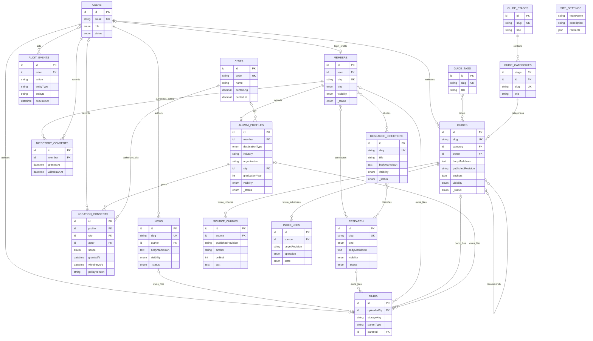

# 数据模型

这是逻辑模型，待 Payload schema 与 migration 实现。数据库采用 PostgreSQL；Payload 管理 ID、timestamps、关系与版本物理表，不手写第二套 ORM 模型。以下表名为逻辑 collection slug，ER 图不展开 Payload 内部版本、认证和多值关系辅助表。[Collections](https://payloadcms.com/docs/configuration/collections)、[Relationship](https://payloadcms.com/docs/fields/relationship)

## 共同约定

所有业务记录有 `id`、`createdAt`、`updatedAt`。内容类 news、research-directions、research、members、guides、alumni-profiles 启用 Payload drafts，具有 `_status=draft|published`；可见性为 `public|internal`。只有已发布且当前用户有权读取的数据进入页面与搜索。公开内容发布时验证所有公开投影字段，不依赖“草稿也必填”。正文不同时维护 Markdown 和富文本两份来源。

slug 在所属 collection 唯一、规范化为小写路径段，改名保留重定向映射在站点配置；锚点唯一性限定在文档内。枚举、外键、唯一约束在数据库/Schema 强制，角色和发布权限仍需服务端 access。业务删除默认先撤回发布；实际删除只由管理员执行，并阻止存在引用的记录被误删。

门户 news/research 的 category 使用模块内受控选项，tags 为规范化字符串数组，Phase 2 增加标签治理与筛选；成员成果从 contributors 关系反查，避免重复存两份。研究方向页正文描述背景与内容，项目和成果按 directions 关系查询。门户搜索作为 Phase 2 扩展明确列入授权搜索白名单，首期指南搜索不假装覆盖全站。

## Collections 与字段

| Collection / Global | 核心字段 | 约束与用途 |
|---|---|---|
| users | email、Payload auth 字段、displayName、role(member/editor/admin)、status(active/disabled) | email 唯一；注册邀请制；role/status 仅 admin 可写；disabled 的现存会话每次请求也拒绝 |
| site-settings（Global） | teamName、description、contactPublic、navigationOrder、redirects[{from,to}] | admin 管理；仅公开字段输出；模块开关不存这里 |
| news | title、slug、summary、bodyMarkdown、publishedAt、category、tags[]、visibility、author→users | 站点动态；实际排序用 publishedAt；公开列表不带内部字段 |
| research-directions | title、slug、summary、bodyMarkdown、visibility | 独立研究方向；启用 drafts；项目与成果通过关系关联 |
| research | title、slug、summary、bodyMarkdown、kind、year、doi、externalUrl、visibility、category、tags[]、directions→research-directions[]、contributors→members[] | kind 为 paper/project/patent/conference；DOI/外链可空；链接校验协议；作者有序 |
| members | name、slug、kind、bioMarkdown、researchInterests[]、directions→research-directions[]、avatar→media?、user→users?、visibility | kind 为 faculty/student/staff/alumni；毕业只更新成员类型，成员 ID 不变；user 若存在唯一；展示资料与登录账号分离 |
| guide-stages | title、slug、sortOrder | 研一、研二、研三等培养阶段 |
| guide-categories | title、slug、stage→guide-stages、description、sortOrder | 阶段下单层分类，形成阶段→分类→指南；删分类前迁移指南 |
| guide-tags | title、slug | 多标签词表，避免自由文本重复 |
| guides | title、slug、summary、bodyMarkdown、category→guide-categories、tags→guide-tags[]、relatedGuides→guides[]、resourceLinks[{label,url}]、owner→users、visibility、publishedRevision、anchors[{key,heading}] | 相关推荐仅返回当前用户有权读取的指南；资源链接限 http/https，外链标识明确；Markdown 唯一正文；owner 负责维护而非额外授权；publishedRevision 为发布快照哈希/标识，发布时生成 |
| media | filename、mimeType、filesize、storageKey、uploadedBy→users、parent(polymorphic relationship)?、alt | parent 只允许 news/research/members/guides/alumni-profiles；一个文件一个父记录；未挂载仅上传者/admin 可读；metadata 同样受控 |
| cities | code、name、countryCode、regionName、centerLng、centerLat | code 唯一；人工维护城市字典；坐标为城市中心，绝非个人 GPS |
| alumni-profiles | member→members、graduationYear、degree、destinationType(employment/further-study/other)、industry?、organization?、bioMarkdown?、city→cities?、visibility | member 唯一且须为 alumni；姓名、slug、头像复用成员，不复制身份；organization 支持单位筛选，industry 支持行业筛选；公开名录须本人明确同意，admin 可代建草稿但不能代授同意；由管理员依据本人提供的证据登记 |
| directory-consents（portal，Phase 1） | member→members、grantedAt、withdrawnAt?、policyVersion、evidenceRef、actor→users | 独立于草稿版本；只允许一个有效授权。公开校友名录、个人页和头像均须实时核对 |
| location-consents | profile→alumni-profiles、city→cities、scope(city-map-public)、approvedFields[]、profileRevision、grantedAt、withdrawnAt?、policyVersion、actor→users?、evidenceRef? | 一次授予一个记录；撤回填 withdrawnAt；再次同意新建记录；只允许一个当前有效同意；线下同意需证据引用，证据不公开 |
| audit-events | actor→users?、action、entityType、entityId、occurredAt、requestId、changedFields[] | 仅系统写与 admin 读；记录发布、权限、同意撤回等关键操作；不写密码、token、问题原文或完整个人资料 |
| source-chunks（后续） | source→guides、publishedRevision、anchor、ordinal、text、visibilitySnapshot、embedding?、embeddingModel?、contentHash | 唯一(source,revision,ordinal)；私有派生数据，不开放 CMS 公共 API；只有已发布指南可入库 |
| index-jobs（后续） | source→guides、targetRevision、operation(upsert/delete)、state(pending/running/succeeded/failed)、attempts、errorCode? | 唯一(source,targetRevision,operation)；重复任务收敛；旧 revision 任务不得覆盖新索引 |

`parent` 在 Payload 用受限多态 relationship 实现，不以任意字符串表名执行查询。media 与正文的关系一致性由保存时验证保证：正文引用的附件必须归属当前记录；迁移/上传的未挂载文件在独立清理任务中处理，不能自动公开。成员头像与校友头像也受父记录可见性和同意限制。[Payload 关系字段](https://payloadcms.com/docs/fields/relationship)、[上传](https://payloadcms.com/docs/upload/overview)

## 完整逻辑 ER 图

图中未来 RAG 实体保留“后续”标记；不存在的实现不应据此建表。site-settings 是单例 Global，图中独立实体不代表遗漏关系。

media 的五条父关系是“至多选其中一条”，并非允许同时属于五个父记录；在 schema 校验及事务中强制。贡献者多对多由 Payload relationship 管理的关系表承载。审计 entityId 保留删除前记录标识，因此是有意不带级联外键的审计引用。

## 校友位置与同意

校友不因维护资料获得内部账号；Phase 2 的城市授权及撤回由管理员依据本人申请与证据记录办理。请求撤回应立即办理，不以重新审核发布为前提。毕业撤销组内账号访问；未来自助校友账号须独立角色。

Phase 1 成员名录包含 kind=alumni 的毕业成员，不采集去向地图字段；Phase 2 通过唯一 member 外键附加 alumni-profiles，复用姓名、头像、公开资料链接。不得为同一个人再建第二份成员。原名录发布许可不自动构成城市展示同意；扩展去向、行业、单位和地图展示需新增明确授权。姓名更新从成员读模型获取，去向筛选从 alumni 读模型获取，调用边界仍由模块服务执行。

地图只展示本人主动选择的城市中心，绝不采集门牌、工作地址、实时 GPS、IP 定位或轨迹。首次保存城市不等于同意公开；同意文案说明公开城市和姓名关联可被任何人看到。城市变更须明确确认展示；未确认时撤回原位置同意。MapLibre 的底图服务另选，客户端网络请求不携带校友账号或精确个人位置。

公开地图记录必须同时满足：alumni 模块开启、关联成员和去向资料均已发布且公开、名录同意有效、city 已选择、当前城市展示同意有效且 consent.city 与 profile.city 一致，profileRevision 对应当前已授权公开的去向版本。地图 API 只返回城市 code/name/中心点、人数、已同意公开的姓名及资料链接；年份、行业、单位和去向类型仅按 approvedFields 参与展示、筛选与计数，资料变化后须重新确认；对外只按城市聚合点，不伪装成个人所在坐标。公开名录与公开城市是两个独立开关；拒绝城市展示仍可进入名录。

名录同意从独立的 directory-consents 读取当前权威值，不能从已发布历史快照复活已撤回同意；该端点仅返回布尔授权结论，不能公开完整草稿。撤回操作事务更新 consent.withdrawnAt 并写审计；读取地图总是查当前有效同意，不读旧草稿、历史版本或缓存快照。地图/名录首期 `no-store`，撤回后的下一次请求不再返回该记录；已有浏览器内存或第三方截图无法追回，界面同意说明如实告知。撤回名录立即阻断所有公开入口，即使地图模块已停用；重新登记名录授权后，旧地图同意也不得恢复（须晚于或等于本次名录授权时间）；管理员只能下架，不能代本人重新勾选。匿名网页不能查询城市字段或 consent 记录本体，只有专门公开投影端点提供合格数据。

个人 city 可留在本人私有资料供以后再选择，但不留在公开版本的输出中；删除账号请求进入管理员核验流程，个人资料与同意证据按已确认的保留政策清理，业务文章作者可匿名化。保留期限在上线前由团队确定，不凭空宣称法律合规。

## 来源与检索一致性

指南发布产生不可混淆的 publishedRevision，并将 Markdown 标题映射为稳定锚点；后台预览能直接检查 `/guides/slug#anchor`。发布修订号描述当前公开/内部已发布快照，编辑草稿不改变它。发布、撤回及权限修改在事务中登记后续索引工作；外部模型失败不能回滚已发布正文。

首期搜索直接读取已授权的当前已发布指南，不建设 source-chunks。后续检索片段必须保留 source、revision、anchor、正文摘录；旧版本、失效锚点或 ACL 变化时拒绝用于回答。向量数据不是事实来源；数据库正文和当前权限才是。用户不可直接请求 chunk ID 导出内部材料。

## 索引、迁移与验证

数据库索引包括各 slug 唯一、user.email 唯一、指南 category、内容 `_status+visibility`、alumni city、consent(profile,scope,withdrawnAt)；当前有效 consent 用 PostgreSQL 部分唯一索引约束，`withdrawnAt IS NULL`。不为首期普通子串查询预先增加向量扩展；数据量证明需要时再评估 trigram 索引并用真实查询计划验证。

全量迁移顺序为 users/cities/stages/categories/tags → 内容 collections → media 关系 → 同意/审计；RAG 表单独后续 migration。数据导入默认草稿和 internal，校友城市默认不公开，禁止从 Excel 中已有城市推断展示同意。关系回填失败必须中止该批次并列出源记录，不默默丢失引用。[Payload migrations](https://payloadcms.com/docs/database/migrations)

实现验收检查唯一约束、孤儿关系、非法城市坐标、Markdown 锚点稳定性、草稿不覆盖线上版本、附件父权限、匿名不能读 users/consents/chunks、并发重复同意、同意撤回的名录/地图输出、删除和恢复后的关系完整性。本文未创建数据库、运行 migrations 或验证实际 API。
